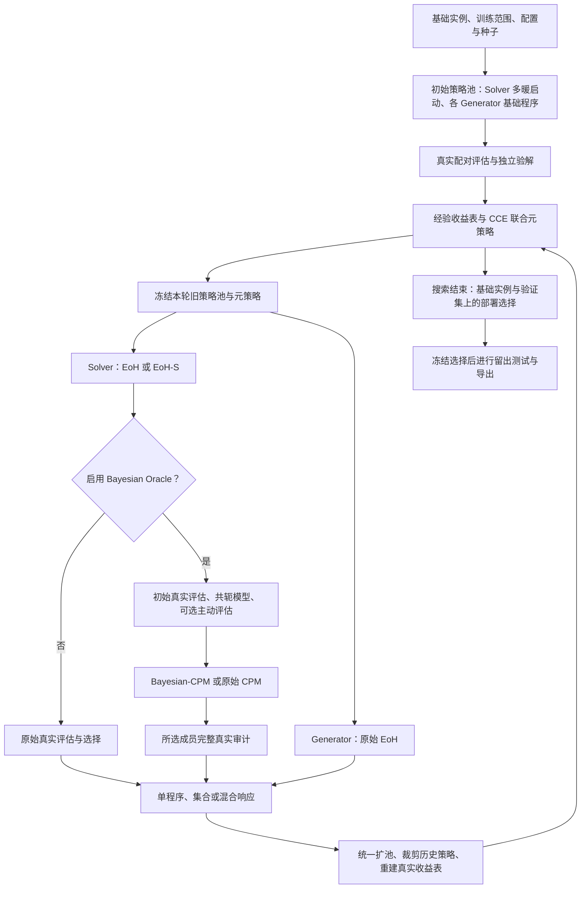

# 项目数学原理与算法结构

本文给出 SND 问题、多主体博弈、EoH-S 与贝叶斯主动评估的数学定义和代码对应关系。

源码模块见 [README](README.md)。实验配置和源码哈希由各自的归档记录。

## 1. 项目目标与总体结构

项目自动生成的是**求解 SND 的 Python 启发式程序**，不是直接让大模型输出某个实例的最优流量。大模型生成程序，真实评估器执行程序并独立验解，搜索过程据此改进程序。

| 层次 | 搜索或计算的对象 | 主要目标 |
| --- | --- | --- |
| SND 求解层 | 弧开启状态与逐商品流量 | 得到满足约束、成本较低的网络方案 |
| 启发式搜索层 | Python 程序及程序集合 | 在有限真实评估和 LLM 调用下发现有效程序 |
| 多主体博弈层 | 求解器响应与各方向生成器响应 | 对当前对手分布搜索响应，扩展策略池并重求 CCE |

BA-MCHRO 在 Solver 的 EoH-S Oracle 内加入性能后验、主动评估和 Bayesian-CPM。它没有将 CCE 替换为贝叶斯博弈，也没有将模型预测写入经验收益矩阵。

循环表示外层迭代；每轮所有玩家基于同一份旧状态搜索响应，全部完成后才更新博弈策略池。

## 2. 统一记号与三种不同的“集合”

| 符号 | 含义 |
| --- | --- |
| $x$ | 完整 SND 实例 |
| $h$、$g_j$ | 纯求解器程序、第 $j$ 个方向的纯生成器程序 |
| $m$ | 生成器主体数量，可选 1 至 6 个不同方向 |
| $\mathcal H$ | 互补求解器程序集合 |
| $K_{\mathrm{pop}}$ | 本地种群容量，对应 `population_size` |
| $S_i^t$ | 第 $t$ 轮玩家 $i$ 的历史博弈策略池 |
| $q$ | 一个混合响应内部的成员权重 |
| $\pi$、$\pi_i$ | CCE 多玩家联合分布及其边际 |
| $Q=\{(x_j,\omega_j)\}_{j=1}^{J}$ | 本次 Oracle 的有限代表实例及归一化权重 |
| $L(h,x)$ | 程序损失，当前 CPI 通常使用目标值相对参考值的原始 gap |

必须区分：

1. **互补集合 $\mathcal H$**：对同一实例取成员最小损失。
2. **混合响应 $q$**：成员效用按概率加权求期望；该响应本身是元博弈的一个动作。
3. **CCE 联合分布 $\pi$**：分布在所有玩家历史动作的联合画像上，可包含跨玩家相关性。

`population_size` 限制本地搜索程序数，`strategy_pool_limit` 限制各玩家历史动作数。一个历史混合动作可包含多个纯程序，历史动作数不等于归档源码数。

## 3. SND 数学模型

### 3.1 静态多商品弧流模型

设有向网络为 $G=(V,A)$，商品集合为 $\mathcal K$。弧 $a$ 的容量、固定费用、单位流量费用为 $U_a,F_a,c_a$；商品 $k$ 的起点、终点、需求为 $o_k,d_k,q_k$。

变量 $y_a\in\{0,1\}$ 表示是否开启弧，$f_a^k\geq0$ 表示商品流量。目标为

$$
\min_{y,f}\quad z(y,f;x)=
\sum_{a\in A}F_a y_a+
\sum_{k\in\mathcal K}\sum_{a\in A}c_a f_a^k.
$$

逐商品流量守恒：

$$
\sum_{a\in\delta^+(v)}f_a^k-
\sum_{a\in\delta^-(v)}f_a^k
=
\begin{cases}
q_k,&v=o_k,\\
-q_k,&v=d_k,\\
0,&\text{其他节点}.
\end{cases}
$$

共享容量与开启约束：

$$
\sum_{k\in\mathcal K}f_a^k\leq U_a y_a,\qquad a\in A.
$$

商品流允许拆分到多条路径；当前不是每商品只能走一条路径的无拆分模型。原始弧流 MIP 含约 $|A|$ 个二进制变量和 $|A||\mathcal K|$ 个连续变量。

`solve_snd(instance)` 返回包含 `arc_open` 与 `flows` 的方案。评估器重新计算目标值，检查标识符、有限数值、弧开启变量、非负流、逐商品守恒及容量，不信任候选自报目标或可行性。

当前只支持已实现的弧流约束。对非空 `paths`、`service_constraints`、`path_constraints`，实例校验拒绝相应未支持输入，不会假装已经处理这些附加约束。

### 3.2 时间展开网络

时间模式将物理节点 $v$ 展开为 $(v,t)$。服务弧连接出发和到达时刻，等待弧连接同一物理节点的相邻时刻，商品释放与截止时间编码进展开起终点和元数据。

求解器仍求解展开图上的同一弧流模型，不能合并时间节点后求静态解。等待弧费用为零；路径长度和服务拥堵指标不计等待弧。

时间展开支持时刻与运输可达性约束，不自动引入车辆循环、车队规模或其他未编码调度约束。展开会显著增加节点、弧和求解成本。

### 3.3 基础实例范围

`SNDInstance` 生成基础网络，`SNDParameterBounds.sample` 在节点、覆盖率、固定费用调节参数和可选时间范围内采样。开启范围配置后，训练基础网络可包含多种规模。

`fixed_cost` / `fixed_cost_adjustment` 是生成参数，不是最终方案中固定费用所占比例。当前固定费用生成乘子为

$$
0.5+1.5\,\text{fixed\_cost\_adjustment}.
$$

实际密度、规模和费用应读取生成后的实例。

源码：[实例生成](m_asro/problems/snd/generator/instance.py)、[弧流 MIP](m_asro/problems/snd/mip/solver.py)、[独立约束检查](m_asro/problems/snd/constraints.py)。

## 4. 参考解、gap 与六项评估指标

### 4.1 参考解如何取得

参考值 $r(x)$ 来自真实可行方案，可以是已证明最优的 MIP 解，也可以只是可行 incumbent。它用于成本差距归一化，并帮助认证生成实例有可行解。

| `reference_method` | 行为 |
| --- | --- |
| `mip` | 求解原始弧流 MIP |
| `heuristic` | 使用配置的残余容量最短路启发式 |
| `auto` | 按复杂度在上述两者间选择 |

当前复杂度为节点、弧、商品数量之和；时间展开还加时间点数。复杂度不超过 `reference_complexity_threshold` 时，auto 选择 MIP。

MIP 默认后端为 SciPy/HiGHS，也支持项目已实现的其他后端。有限时间或非零 MIP gap 下的可行解不能一概称为精确解。`mip_reference` 仅在状态与 gap 满足严格条件时标记 `optimal`，否则标记 `incumbent`。

启发式参考通过残余容量路径增广、不同顺序或权重扰动多次构造，保留成本最低的可行结果：

- `reference_restarts`：启发式构造重复次数，不是重复求解 MIP。
- `reference_max_paths`：启发式每商品路径增广次数上限。
- `time_limit`：MIP 后端求解时间。
- `reference_timeout`：整个参考子进程时限，包括启动、建模和传输。
- `reference_mip_fallback=True`：MIP 失败可回退启发式，可能再消耗一段参考超时预算。

没有取得参考可行解表示认证未完成，不等于证明数学不可行。

### 4.2 原始 gap

对独立验解通过的方案：

$$
\ell(h,x)=\operatorname{gap}(z(h,x),r(x))
=\frac{z(h,x)-r(x)}
{\begin{cases}|r(x)|,&r(x)\neq0,\\1,&r(x)=0.\end{cases}}
$$

当前 CPI 和贝叶斯连续损失通常使用该原始 gap。若参考只是可行 incumbent，负 gap 表示优于参考方案，不表示优于全局最优值。

失败执行没有合法连续损失，观测值为 `None`；选择用失败惩罚另外记录。

### 4.3 六项指标

记弧负载 $v_a=\sum_k f_a^k$，服务弧集为 $A_{\mathrm{srv}}$，定义

$$
b(s)=\frac{\max(0,s)}{1+\max(0,s)}.
$$

| 指标 | 当前计算方式 |
| --- | --- |
| `cost` | $b(\operatorname{gap}(z,r))$ |
| `path` | $b(\operatorname{gap}(\sum_{a\in A_{\mathrm{srv}}}v_a,\underline P))$ |
| `transport` | $b(\operatorname{gap}(\sum_a c_a v_a,\underline T))$ |
| `fixed` | $\sum_a F_a y_a/\max(\sum_a F_a,10^{-12})$ |
| `congestion` | $\min(1,\max_{a\in A_{\mathrm{srv}}}v_a/\max(U_a,10^{-12}))$ |
| `work` | $\min(1,N_{\mathrm{line}}/\text{work\_budget})$ |

$\underline P$ 是忽略容量和固定费用后的需求加权最少服务弧数下界；$\underline T$ 是相应最小运输费用下界。等待不增加服务跳数。

`work` 是候选源码中追踪到的 Python 行执行次数的归一化，不是源码行数、CPU 指令数或墙钟。导入模块内部执行不完整计入该指标。

原始 gap、截断后的 `cost`、六项综合效用是不同数值；负 gap 在 cost 中截断为零。

源码：[评估与缓存](m_asro/problems/snd/evaluation.py)、[参考求解](m_asro/problems/snd/reference.py)、[效用](m_asro/core/utilities.py)。

## 5. Solver–Generator 一般和星形博弈

### 5.1 玩家与效用

一个 Solver、$m$ 个不同方向 Generator。可选方向：

`cost`、`path`、`transport`、`fixed`、`congestion`、`work`。

**所有玩家均最大化各自效用。** Solver 倾向降低综合损失，Generator 倾向增加自己负责方向的困难程度，同时承担扰动惩罚。

对成功求解的合法认证实例：

$$
u_0(h,x)=-\sum_{r=1}^{6}w_rM_r(h,x),\qquad
u_j(h,g_j)=M_j(h,x)-\lambda D(x,x_0).
$$

权重非负并归一化；`UtilityConfig` 默认六权重依次为

$$
(0.55,0.10,0.10,0.10,0.10,0.05).
$$

这是库默认值，demo 或具体训练可以另设。

Generator 生成实例非法时：

$$
(u_0,u_j)=(0,-P_{\mathrm{fail}}).
$$

实例合法且参考可行，但 Solver 不可行、异常或超时时：

$$
(u_0,u_j)=(-P_{\mathrm{fail}},1-\lambda D).
$$

代码要求 $P_{\mathrm{fail}}>1$。两方效用一般不互为相反数，因此不是零和博弈。

### 5.2 Generator 扰动范围

`generate_snd(base_instance, seed)` 允许改变容量、固定费用、单位运输费用和商品需求，要求：

- 保持节点、弧、商品的 ID、端点、数量和顺序。
- 数值处于基础值 $[0.5,2]$ 倍；零基础值仍为零。
- 保持时间拓扑与时刻信息，等待弧费用仍为零。
- 同步时间商品需求与窗口中的需求。
- 通过实例检查及真实参考可行性认证。

扰动惩罚为允许数值字段上的平均相对绝对变化：

$$
D(x,x_0)=\frac1N\sum_{r=1}^{N}d_r,\qquad
d_r=
\begin{cases}|x_r/x_{0r}-1|,&x_{0r}\neq0,\\0,&x_{0r}=0.\end{cases}
$$

零基础字段仍参与计数。该惩罚鼓励有针对性的难例，抑制只靠大幅改数值取得奖励。

### 5.3 经验收益表

每个方向保留两张真实收益表：

$$
A_j[p,q]=\frac1m\widehat{\mathbb E}[u_0(s_p,g_{j,q})],
\qquad
B_j[p,q]=\widehat{\mathbb E}[u_j(s_p,g_{j,q})].
$$

期望由 `instances_per_generator` 个固定编号样本的真实均值估计；概率混合动作按成员权重精确展开。

联合画像 $a=(a_0,\ldots,a_m)$ 的收益为

$$
U_0(a)=\sum_{j=1}^{m}A_j[a_0,a_j],\qquad
U_j(a)=B_j[a_0,a_j].
$$

所有边共享一个 Solver 动作，不是分别求解 $m$ 个独立二人博弈。

## 6. CCE 元策略与外层迭代

### 6.1 CCE 线性规划

`CCEMetaSolver.solve` 枚举当前全部联合画像，求解：

$$
\begin{aligned}
\min_{\pi,\varepsilon}\quad&\varepsilon\\
\text{s.t.}\quad&
\sum_a\pi(a)[U_i(a_i',a_{-i})-U_i(a)]\leq\varepsilon,
&&\forall i,\ \forall a_i'\in S_i,\\
&\sum_a\pi(a)=1,\quad\pi(a)\geq0,\quad\varepsilon\geq0.
\end{aligned}
$$

这是对固定单边动作偏离的粗相关均衡约束。当前由 SciPy `linprog(method="highs")` 求解，不通过后验改变 LP。

结果包含联合分布、边际、联合期望效用、各方偏离及 `cce_gap`，另计算边际乘积分布的 `product_nash_conv`。

CCE 允许相关性，$\prod_i\pi_i$ 通常不等于 $\pi$，不能直接称为纳什均衡。当前联合期望收益使用联合分布；固定新动作的偏离收益可利用星形结构只使用有关对手边际。

### 6.2 外层流程

第 $t$ 轮在已有 $\pi^{t-1}$ 后：

1. 冻结旧池与旧元策略。
2. 各玩家搜索近似响应。
3. 计算新响应相对旧联合期望效用的正偏离。
4. 裁剪旧策略并加入响应。
5. 真实更新收益表。
6. 重求 CCE，保存训练、验证诊断。

Solver 与第 $j$ 个 Generator 的真实适应度分别为

$$
F_0(h)=\frac1m\sum_{j=1}^{m}
\sum_{g\in S_j}\pi_j(g)\widehat{\mathbb E}[u_0(h,g)],
$$

$$
F_j(g)=\sum_{s\in S_0}\pi_0(s)\widehat{\mathbb E}[u_j(s,g)].
$$

Generator 继续使用原始评估和效用，不经过 Bayesian-CPM。

外部响应诊断为

$$
d_i^t=\max\{0,F_i(\mathrm{response}_i^t)
-\mathbb E_{\pi^{t-1}}[U_i]\}.
$$

当 $\sum_i d_i^t$ 连续满足容差可提前停止。这只是有限 LLM 搜索没有发现更强响应，不是对所有程序的均衡证明。

### 6.3 策略池与规模

$$
N_{\mathrm{profile}}=\prod_{i=0}^{m}|S_i|.
$$

`strategy_pool_limit` 限制每玩家历史动作数；需要腾出空间时保留旧 CCE 边际较高的策略，为新响应留位置，还按 `max_profiles` 收紧有效容量。裁剪改变当前有限博弈，不保证保留全部历史偏离方向。

`max_profiles` 是显式枚举上限，不是程序评估预算。

源码：[CCE](m_asro/core/game.py)、[外层调度](m_asro/core/solver.py)。

## 7. 程序表示、EoH 算子与候选规则

### 7.1 程序和提示词

`Program` 保存源码、说明、代码哈希、玩家、父代、算子和轮次。集合保存成员 ID，混合动作另存权重。

提示词包含任务、算子说明、期望输出、注意事项、父代，并加入效用、对手源码及边际概率。CS/LS 还获得逐实例向量和 CPI。

外置模板 `operator_prompts.txt` 包含：

> 禁止直接套用简单遍历算法与目前已有的成熟启发式算法。

这是生成引导，不是自动创新性证明。`EXPLANATION` 是建议格式，不作为强制准入条件。

### 7.2 原始 EoH

| 算子 | 父代数 | 职责 |
| --- | --- | --- |
| I1 | 0 | 从零初始化 |
| E1 | 2 | 多样性探索 |
| E2 | 2 | 共享思想重组 |
| M1 | 1 | 语义改进 |
| M2 | 1 | 参数调整 |
| M3 | 1 | 简化剪枝 |

先 I1，再按内层轮次执行算子。源码去重后按真实适应度排序，通过 `topk` 或文本聚类代表选择保留程序。文本聚类不是后验互补选择。

`n_candidates` 是单次请求期望输出的代码数，不是并发数。请求按 `llm_retries` 重试；耗尽后继续使用已有候选，若有限搜索最终仍无合格非暖启动程序，依然可能失败。

### 7.3 当前检测边界

静态校验仅包含 Python 语法/编译，以及源码行数、字符数、AST 节点上限。

当前不因装饰器、容器默认参数、函数调用默认参数、`nonlocal`、类或普通导入本身拒绝程序。执行环境提供完整 builtins，

运行时仍要求入口可调用、返回结构正确、通过超时/执行行数限制和独立验解。语法允许不代表执行成功。

候选由 spawn 子进程执行。当前隔离用于限制失控运行，**不是恶意代码权限安全容器**，没有完整文件、网络或系统调用沙箱。

源码：[算子](m_asro/llm/operators.py)、[模板](m_asro/llm/operator_prompts.txt)、[提示词](m_asro/llm/prompts.py)、[执行](m_asro/runtime/execution.py)。

## 8. EoH-S：互补程序共演化

### 8.1 CPI 与目标分布

对共同代表实例 $Q$，$\omega_j\geq0,\sum_j\omega_j=1$：

$$
C_Q(\mathcal H)=
\sum_{j=1}^{J}\omega_j\min_{h\in\mathcal H}L(h,x_j).
$$

先对每个实例取成员最小损失，再对实例平均。CPI 越小越好，不能先对每个程序求均值再取最小值。

总体研究目标可写为

$$
C_{P_*}(\mathcal H)=
\mathbb E_{X\sim P_*}\left[\min_{h\in\mathcal H}L(h,X)\right],
$$

但当前直接计算或估计的是有限 $Q$ 上的 $C_Q$。二者的泛化联系需要代表性及统计假设，不能自动等同。

### 8.2 当前代表实例和权重

`_eohs_scenarios` 从训练基础网络出发，加入当前各 Generator 历史策略及其纯成员生成的合法实例，以完整内容哈希去重。

- `cpi_mode="mean"`：保留实例等权。
- `cpi_mode="weighted"`：基础权重为 1，新生成实例权重为 $1+\pi_j(g)q_g(\mathrm{member})$，再由 CPI 函数归一化。
- 元概率为零的历史 Generator 也可能被枚举。
- 同内容只保留首次加入项，不累加重复来源权重。

weighted 是活跃难例加权设计，不是严格重建 CCE 下的实例概率分布。本次响应内目标固定，外层轮次间可变。

### 8.3 原始 CPM

先选平均损失最低的 singleton，再反复加入边际 CPI 改善最大的候选：

$$
\Delta(h\mid\mathcal H)=
C_Q(\mathcal H)-C_Q(\mathcal H\cup\{h\}).
$$

对非空集合与有限共同损失，$\Delta\geq0$。当前 CPM 候选足够时填满 $K_{\mathrm{pop}}$，不会仅因剩余增益为零就停止。

`cpi` 使用归一化权重；辅助函数 `marginal_cpi_gain` 返回未归一化加权和。同目标下排序不变，但其数值不能未经归一化直接当作 CPI 差。

### 8.4 CS 与 LS

- CS 按无权 $L_1$ 性能向量距离选差异大的两个父代，提示 LLM 补短板。
- LS 按无权平均损失选较好的单父代，提示 LLM 改进逻辑。
- 即使 CPI weighted，这两个父代规则仍使用上述无权量。
- 二者是代码生成算子，不是直接枚举 SND 流量变量邻域。

原始路径形成完整真实向量；Bayes 路径先用稀疏证据选择，再补齐入选成员真实审计，CS/LS 使用审计后向量。

### 8.5 失败单元格和停滞

原始失败保留为非有限或缺失状态。用于选择和父代比较时，`finite_failure_vectors` 定义有限决策惩罚：

$$
L^{\mathrm{decision}}_{hj}=
\max_{\text{同实例有限对照}}L_{\cdot j}
+s_{\mathrm{type}}\,\text{cpi\_failure\_margin}.
$$

无有限对照时基线为 0。严重度为执行行数超限 1、超时 2、其他失败 3。它不是成功观测、真实 gap 或经验收益。

上述分级在提供失败类型时生效；未提供类型的辅助调用沿用统一的一个 margin。Bayes 的失败覆盖则在每个后验 draw、同一实例上取非失败成员的最差值后加惩罚，仍不进入回归似然。

停滞检测使用固定训练基础实例子集上的 CPI。达到耐心阈值后，可在下一次 Solver 响应重启本地种群，重用历史纯程序；次数有限，不删除博弈归档。

源码：[CPI、CPM、CS/LS](ba_eoh_s/eoh_s.py)、[搜索集成](m_asro/core/solver.py)。

## 9. 多暖启动与退出

通过 `warm_start_algorithms` 选择预置程序：

| 名称 | 当前实现 |
| --- | --- |
| `variable_cost` | 按单位运输费用构造残余容量路径 |
| `fixed_cost_greedy` | 加入未开启弧固定费用分摊，复用已开启弧 |
| `capacity_aware` | 在分摊费用外加入残余容量比例惩罚 |
| `grasp` | 基于弧 ID 对同一构造作确定性小幅权重扰动 |
| `genetic_algorithm` | 调用项目通用模块的有界遗传搜索 |
| `simulated_annealing` | 调用有界模拟退火 |
| `tabu_search` | 调用有界禁忌搜索 |

`grasp` 是简化扰动构造，不是完整随机贪婪、自适应列表和局部改进的 GRASP。后三种包装器内部固定 8 秒、seed=0 及较小搜索设置；内部预算未通过暖启动名称参数单独暴露。

库默认只用 `fixed_cost_greedy`，demo 可另设。所有暖启动均可能因贪心路由或有限预算失败。

暖启动用于初始化、父代与真实对照，不能进入最终 Solver 响应或导出。识别除标签外还比较预置源码 AST，忽略注释与格式，并递归检查复合成员；不属于任意程序的语义等价检测。

退出路径有差异：

- 原始非 Bayes：不同源码非暖启动候选达到 $K_{\mathrm{pop}}$ 后永久移出本地种群；数量达到不代表均通过部署验证。
- Bayes：先选非暖启动并完成真实审计和可靠性筛选，再按合格数判断退出。未满时，剩余训练槽位可暂留暖启动。
- 本地退出不删除归档或外层历史暖启动动作。
- 无论是否退出，最终 Solver 响应和部署始终排除暖启动。

“暖启动仅暂留为训练父代/对照”说明本地仍有临时暖启动，不能据此推断整个历史池的数量。

源码：[预置程序](m_asro/problems/snd/baselines.py)、[退出判断](m_asro/core/solver.py)、[Bayes 父代](ba_eoh_s/bayesian/oracle.py)。

## 10. 观测、缓存和数据隔离

### 10.1 可追溯观测

`EvaluationObservation` 包括：

| 类别 | 字段 |
| --- | --- |
| 程序 | `program_id`、`code_hash`、`player` |
| 实例及来源 | `generator_id`、`generator_direction`、`instance_hash`、`instance_features` |
| 采样 | `seed`、`sample_index` |
| 数据划分 | `evaluation_split` |
| 结果 | `observed_performance`、`solver_utility`、`feasibility_status`、`failure_reason` |
| 参考与耗时 | `reference_kind`、`reference_value`、`evaluation_time` |
| 来源 | `cache_hit`、`observation_source` |
| 一致性 | `configuration_signature`、`feature_schema_version` |

来源区分 `real_execution`、`cache_reuse`、`posterior_prediction`。

失败保留原因与耗时，连续损失为 None；预测不冒充真实执行。缓存可恢复已有真实证据，不能增加独立似然权重。

### 10.2 身份与去重

| 对象 | 主要身份 |
| --- | --- |
| 纯生成器样本 | 代码哈希、玩家、样本编号 |
| 纯 Solver 真实评估 | 代码哈希、实例内容哈希，位于固定配置评估器内 |
| 参考内存缓存 | 实例内容哈希 |
| 参考磁盘缓存 | 实例内容与参考配置签名 |
| 观测溯源记录 | 代码、实例、split、seed、配置签名 |
| 模型有效似然样本 | 代码、实例、split、配置签名，不因 seed 改变重复计数 |

`digest` 对完整 JSON 内容作确定性 SHA-256，排序字典键，但列表顺序、元数据仍属于内容。它不是只对拓扑或特征求哈希；同特征不代表同实例。

相同确定性程序、实例、配置的重复运行不是独立统计样本。实际重复执行的成本仍计入执行记录，不能因统计去重抹去。

### 10.3 种子与划分

同方向、同编号样本共享

$$
\text{seed}_{j,r}=
\operatorname{int}(
\operatorname{digest}([\text{global seed},j,r])[:8],16).
$$

候选生成器由此使用共同随机数；编号循环映射到训练基础网络。

自动采样使用不同偏移：

| 用途 | seed |
| --- | --- |
| 范围模式训练基础网络 | `seed + 20000 + i` |
| 验证 | `seed + 15000 + i` |
| 留出测试 | `seed + 10000 + i` |

验证用于部署排序、可行性门槛及逐轮诊断，不进入训练收益表或 Oracle 后验。测试在选择冻结后报告；启动时准备测试参考值不等于用候选测试性能参与选择。

Bayes Oracle 显式拒绝训练内容与验证/测试重叠。不同 seed 本身不证明无泄漏，手工提供实例还需确保内容和来源隔离。

通用模型可显式 fit validation 进行独立分析，但集成 Oracle 只拟合 training。显式分析用途不能与默认训练行为混写。

源码：[观测管理](ba_eoh_s/bayesian/observations.py)、[真实缓存](m_asro/problems/snd/evaluation.py)。

## 11. 贝叶斯性能模型

### 11.1 不确定性来源

固定确定性程序与实例的损失不会因为使用 Bayes 而随机。后验表示有限观测下对未评估损失规律的认识，以及线性近似误差。

若候选使用未固定随机数或受墙钟截止影响，会有额外输出随机性；当前确定性去重与单元格锚定未完整建模重复运行分布。

### 11.2 特征

仅从实例提取 18 个特征，不读取参考值、候选结果或测试标签：

| 类别 | 特征 |
| --- | --- |
| 规模 | 物理节点、展开节点、弧数、弧密度、商品数 |
| 需求 | 总需求、平均需求、最大需求、需求变异系数 |
| 容量 | 总容量、总容量/总需求、最小容量/平均商品需求 |
| 费用 | 平均运输单价、平均固定费用、固定费用比例 |
| 时间 | 时间段、服务弧数、等待弧数 |

特征固定费用比例为

$$
\frac{\sum_a F_a}{\sum_a F_a+\sum_a c_a},
$$

不是解的固定费用占比。时间密度按物理图计算。

原始特征不作 log 变换；按成功真实观测行的均值、标准差标准化，近零标准差替换为 1。同实例被多程序成功评估时出现多行，缩放器并非对不同目标实例等权拟合。加截距后 $\phi(x)$ 为 19 维。

### 11.3 共轭高斯线性回归

`BayesianPerformanceModel` 对每个程序独立建立

$$
y_{hj}=\phi(x_j)^\top\beta_h+\epsilon_{hj},
\qquad\epsilon_{hj}\sim\mathcal N(0,\sigma^2),
$$

$$
\beta_h\sim\mathcal N(\mu_0,\Lambda_0^{-1}).
$$

默认 $\mu_0=0,\Lambda_0=I$。噪声为已知固定方差，没有学习逆 Gamma 或层次方差后验。

模型独立构造时 `observation_noise` 默认 1.0；集成 Oracle 默认传 0.0025，即标准差 0.05。该参数表示**方差**。

对成功真实训练数据 $X_h,y_h$：

$$
\Lambda_h=\Lambda_0+\frac{X_h^\top X_h}{\sigma^2},
\qquad
\Sigma_h=(\Lambda_h+\rho I)^{-1},
$$

$$
\mu_h=\Sigma_h
\left(\Lambda_0\mu_0+\frac{X_h^\top y_h}{\sigma^2}\right).
$$

$\rho$ 是默认 0 的可选 ridge。后验为
$\beta_h\mid D\sim\mathcal N(\mu_h,\Sigma_h)$。

单点预测：

$$
Y_h(x)\mid D\sim\mathcal N\left(
\phi(x)^\top\mu_h,\
\phi(x)^\top\Sigma_h\phi(x)+\sigma^2
\right).
$$

失败、预测来源与其他 split 不加入回归似然。稀疏矩阵无需事先补齐，各程序只用自己的成功行。

`update` 当前重算缩放器并从记录重建后验，不是常数时间秩一递推。维度较低使其成本可控，历史大量增长仍有开销。

### 11.4 冷启动

无数据程序可获得先验预测供诊断，不能仅凭乐观先验进入正式 CPM。集成流程要求真实初始评估、成功数达到 `min_observations`，并通过可靠性规则。

程序之间不共享系数，尚不支持跨程序迁移。`expected_loss(program)` 未指定实例时平均该程序已观测设计点的预测，不自动表示 $P_*$ 下期望。

### 11.5 联合预测与已知单元格

集合选择用 `joint_posterior_predictive`：

1. 每 draw 为每程序抽一次 $\beta_h^{(b)}$。
2. 用同参数预测所有共同实例。
3. `include_noise=True` 时加入不同实例残差，同内容共享残差。
4. 已知成功真实单元格固定为真实损失。

同程序的跨实例协方差为

$$
\operatorname{Cov}(Y_h(x),Y_h(x')\mid D)
=\phi(x)^\top\Sigma_h\phi(x')
$$

并在同内容情形包含残差项。不同程序当前独立，**未学习跨程序相关性**。共同实例和相同 draw 编号不等于层次相关模型。

`posterior_predictive` 的单点边际可用于均值、标准差与校准诊断，不能随意拼成正确协方差的集合样本；集合应使用联合接口。

Gaussian 预测不强制满足 gap 物理范围。没有实际校准证据，不能宣称区间已对真实 SND 分布校准。

源码：[特征](ba_eoh_s/bayesian/features.py)、[共轭模型](ba_eoh_s/bayesian/linear_model.py)、[联合统计](ba_eoh_s/bayesian/posterior.py)。

## 12. Bayesian-CPM

### 12.1 后验 CPI 与增益

对固定 $Q$，联合样本为 $L^{(b)}_{hj}$，$b=1,\ldots,B$：

$$
C_Q^{(b)}(\mathcal H)=
\sum_j\omega_j\min_{h\in\mathcal H}L_{hj}^{(b)},
$$

$$
\Delta^{(b)}(h\mid\mathcal H)=
C_Q^{(b)}(\mathcal H)-
C_Q^{(b)}(\mathcal H\cup\{h\}).
$$

前后用同一联合样本库。不能把不同实例真实表现直接相减，也不能独立重抽 before/after 后冒充配对差值。

$$
\mathrm{BMG}=\frac1B\sum_b\Delta^{(b)},\qquad
\widehat P(\Delta>\epsilon)=
\frac1B\sum_b\mathbf1\{\Delta^{(b)}>\epsilon\}.
$$

区间用等尾后验分位数，均值 MC 标准误 $s/\sqrt B$，改善概率标准误另报。后验不确定性与有限 MC 误差不同。

### 12.2 选择步骤与边界

先按真实证据和可靠性过滤，再：

1. 选后验平均 singleton CPI 最低的首成员。
2. 逐次加后验平均边际增益最大的程序。
3. 达容量或无合格候选后停止。
4. 报告成员、后验 CPI、增益区间与改善概率。

空集 CPI 无有限定义，首步按 singleton 排序。当前 `epsilon` 仅用于改善概率，不是准入或早停阈值；候选足够仍可能填入零增益成员。

后验 CPI 描述固定代表集上未评估单元格。相关单元格全观测后区间可坍缩，不表示未来实例泛化误差为零。

已知失败使用明确标记的决策惩罚，不作为成功损失拟合。目前没有独立概率可行性回归。最终验证真实运行，收益走原效用；后验 CPI 更低不保证 mixed utility 更高。

源码：[Bayesian-CPM](ba_eoh_s/bayesian/bayesian_cpm.py)。

## 13. Bayesian Active Evaluation

### 13.1 初始化与目标

主动评估选择真实动作 $e=(h,x)$，改善最终集合选择，不只是降低单个单元格预测方差。当前实现 `ucb`、`random`、`uniform`，不含嵌套 EVI。

首先在共同实例列上给新程序少量真实观测。初始列按实例索引等间距选择，不是按规模或特征聚类分层。历史真实记录可复用，冷启动与失败补测消耗相同真实预算。

### 13.2 互补感知 UCB

对候选 $h$，控制集取当前集合 $\mathcal H\setminus\{h\}$；若为空则尝试其他合格 singleton。

局部增益：

$$
d_{hj}^{(b)}=
\max\left\{
\min_{a\in\mathcal H_{\mathrm{ctrl}}}L_{aj}^{(b)}
-L_{hj}^{(b)},0
\right\}.
$$

总增益及 UCB：

$$
\Delta_h^{(b)}=\sum_j\omega_jd_{hj}^{(b)},\qquad
\mathrm{UCB}_h=\overline\Delta_h+\kappa s(\Delta_h).
$$

实例影响量近似：

$$
I_{hj}=\omega_j
\left(|\overline d_{hj}|+\kappa s(d_{hj})\right).
$$

当前采集评分：

$$
\mathrm{score}(h,x_j)=
\frac{\max(\mathrm{UCB}_h,0)\,I_{hj}}
{\widehat{\mathrm{cost}}(\mathcal B_{hj})}.
$$

$\mathcal B_{hj}$ 为候选和控制在同实例上的待补齐评估包。无其他控制时有 singleton 退化规则，以负损失引导；此时不能声称已经取得集合互补增益。

这是低成本决策价值近似，不是严格 EVI、知识梯度或最优试验设计。

### 13.3 成对补齐与成本

执行包时查真实记录，复用缓存，补齐每个缺失成员，分别保存成功或失败，并记录配对是否完整。

缺失对照不是免费标签。不能在预算外补齐后只统计候选执行。

`cost_mode="fixed"` 按缺失次数乘默认成本；`"observed"` 用程序历史耗时均值。当前没有实例特征驱动的成本回归。

计数准入要求整个缺失包可容纳。墙钟限制可能在包中途阻止后续运行，此时只保留实际证据，不能宣称完整配对已完成。

### 13.4 探索、批次与停止

- `min_exploration_fraction` 按配对动作而非底层执行次数约束探索比例。
- uniform 平衡候选及实例暴露，random 从可准入包随机选择。
- `batch_size` 是配对动作数，一批可沿用同一后验库，随后重拟合。
- 初始化、补测、对照、审计都计入对应真实预算。
- 可因计数、墙钟、信息评分阈值、无新单元格或无可容纳包停止。

`finished 真实=16/108` 不自动表示异常，预算是上限，不要求用完。

| 终端事件 | 含义 |
| --- | --- |
| `evaluation_start` | 即将开始一个真实程序—实例评估 |
| `evaluation_done` | 已记录该次结果与可行/失败状态 |
| `paired_action` | 选定候选及其共同实例对照包 |
| `paired_complete` | 已补齐该包 |
| `finished` | 本次主动阶段结束，仍需查看停止原因与后续审计 |

源码：[主动控制器与真实评估适配器](ba_eoh_s/bayesian/active_evaluation.py)。

## 14. BA-MCHRO 与 M-PSRO 集成

### 14.1 配置组合

当前集成 Bayesian Oracle 要求 `eoh_framework="eoh-s"` 且 `response_mode="mpsro"`。

`BayesianOracleConfig.enabled` 当且仅当启用 Bayesian-CPM 或主动评估。

| `cpm_method` | `active_evaluation` | 流程 |
| --- | --- | --- |
| `original` | `False` | 原始 EoH-S 评估与 CPM，不建立 Bayesian Oracle |
| `bayesian` | `False` | 全部候选真实评估后 Bayesian-CPM，仍受 Oracle 预算 |
| `original` | `True` | 主动取得稀疏证据，原始 CPM 只使用真实共同观测列 |
| `bayesian` | `True` | 主动评估与 Bayesian-CPM 同时启用 |

主动采集内部仍使用后验互补信息。因此 active-only 配置不是整个流程不含 Bayes 的对照。

### 14.2 Oracle 数据流

`SolverOracleSession` 在一次外层 Solver 响应内贯穿 I1 和全部内层阶段：

$$
\text{生成候选}
\rightarrow\text{初始证据/主动评估}
\rightarrow\text{模型拟合}
\rightarrow\text{集合选择}
\rightarrow\text{完整真实审计}
\rightarrow\text{原始加权收益响应}.
$$

真实执行链：

`SolverOracleSession` → `_LedgerBackend` → `SNDEvaluationBackend` → `SNDEvaluator.evaluate` → 子进程 → `validate_solution`。

外层响应开始前冻结缓存，Oracle 使用私有可变缓存，结束后发布真实结果，防止并发 Generator 在时序上免费提供不同标签。执行限制和参考规则与原评估器一致，预测不填补经验收益。

私有和主评估器仍可能各自真实执行同单元格；时间成本存在，模型不增加独立样本。总训练成本应查看全局计时与底层执行，而不只看 Oracle 数字。

### 14.3 预算准确作用域

`evaluation_budget` 是**一次外层 Solver 响应**上限，跨内层阶段共享，包含初始化、主动补测、成对对照、临时暖启动对照及审计。

每阶段按剩余阶段分配预算，预留最坏情况完整审计：

$$
B_{\mathrm{active,stage}}\approx
\max\left(
0,\
\left\lfloor
\frac{B_{\mathrm{remaining}}}{N_{\mathrm{stages,left}}}
\right\rfloor
-B_{\mathrm{audit,reserve}}
\right).
$$

预留可能保守，因此整个响应还有余额时本阶段主动额度也可为零。

这不是总训练预算：Generator 搜索、其他收益表评估、参考求解、验证、测试都有额外成本。

`max_wall_time` 从会话创建开始，包含后续 LLM 生成、排队、推断与阶段停顿，不只计真实评估时间。达到后拒绝新真实执行；不放宽已准入执行的原有硬超时。

### 14.4 保持不变的机制

玩家与效用、响应旧快照、Generator 搜索、混合成员权重、真实经验表、CCE LP、外层扩池、最终验解与回退继续使用原实现。

Bayes 改变 Oracle 的证据和候选选择，不保证原混合效用提高。因此分别记录 `portfolio_cpi`、`portfolio_cpi_source` 与 `mixed_response_utility`。

源码：[Oracle 配置、账本、审计](ba_eoh_s/bayesian/oracle.py)、[Solver 集成](m_asro/core/solver.py)。

## 15. 训练可靠性与历史失败

历史失败保留，不直接等于永久淘汰。当前 Bayes 规则针对当前目标中已观测的不同实例，与连续损失回归分离。

### 15.1 失败分类

- 语法、源码超限：拒绝源程序。
- 不可行解、运行异常：本次失败，不能作为可行解或成功损失。
- 超时、执行行数超限：给定预算下失败，保留原因与成本。
- 参考认证失败不能简单归结为候选数学错误。

### 15.2 失败率门槛

默认 `failure_rate_min_instances=10`、`max_failure_rate=0.05`。

在已观测的不同目标实例 $O_h$ 上：

$$
\widehat f_h=
\frac{\sum_{j\in O_h}\omega_j\mathbf1\{\text{失败}\}}
{\sum_{j\in O_h}\omega_j}.
$$

准入逻辑：

1. 语法或源码超限证据直接拒绝。
2. 有失败、不同实例不足 10：可靠性证据不足，预算内补测。
3. 有失败、实例足够：比较加权失败率与 5%。
4. 始终要求成功真实观测数达到 `min_observations`。

无失败候选不必先达到 10 个实例。均匀权重下 107 成功、2 超时的失败率约 1.83%，可通过此训练门槛；非均匀时不一定等于次数比。

这是经验配置，不是后验置信上界或未知实例可靠性保证。审计发现新失败后再判断；真实收益仍按原失败效用，已知失败格仍受决策惩罚。

### 15.3 保留不等于自动重试或复活

相同确定性缓存失败不会为了取得更好结果反复运行，补测优先换不同实例。

历史保留也不意味着所有被本地种群移出的候选自动复活，后续仍受父代、候选池与预算约束。

训练容忍小比例失败，不取消最终基础实例、验证和混合可靠性门槛。中断导出还要求完整成功真实审计。

源码：[失败分类和门槛](ba_eoh_s/bayesian/failure_policy.py)、[证据汇总](ba_eoh_s/bayesian/linear_model.py)。

## 16. 响应、最终选择与部署

### 16.1 三种响应

| 配置 | Solver 博弈动作 | 执行语义 |
| --- | --- | --- |
| `eoh + pure` | 单程序 | 运行该程序 |
| `eoh-s + pure` | 互补集合 | 运行全部成员，择最低目标可行解 |
| `mpsro` | 概率混合响应 | 博弈按成员权重期望；实际部署抽取及失败回退 |

EoH-S 的 mpsro 默认 `eohs_mixture_selection="cpm"`，保留完整 CPM 集合并等权；该分支不再用 `mixture_support_size` 或 `mixture_epsilon` 删掉补短板成员。

原始 EoH 和 Generator 通常按真实效用容差选混合支持，受 support size 限制；EoH-S 也可显式用 utility 分支。

### 16.2 CPI 与混合效用不同

对可行有限损失：

$$
\sum_j\omega_j\min_h L(h,x_j)
\leq
\sum_j\omega_j\sum_h q_h L(h,x_j).
$$

例如 $L(h_1)=(0,1)$、$L(h_2)=(1,0)$，等权实例的集合 CPI 为 0，等权混合损失为 0.5。集合互补好不直接证明随机抽一个成员效果好。

原混合收益为

$$
u_i(q_s,q_g)=
\sum_h\sum_gq_s(h)q_g(g)u_i(h,g),
$$

包含真实失败惩罚及六项指标。`pair` 精确展开，不用一次抽样估计。

### 16.3 部署与回退

- `EnsembleSNDSolver` 运行全员取最低成本可行解，work 按实际全员总追踪量计算。
- `MixedSNDSolver` 根据 seed、策略和实例内容确定首选成员，失败后按权重降序回退，同权按原顺序。
- 不平均流量变量，不按模型预测挑最终方案。
- 实际“抽取后回退”与博弈“无回退加权期望”分别报告，脆弱成员可能导致差异。
- `mixture_distribution` 列出每成员真实结果及加权成功率，避免将至少一个成员成功说成每次抽取均可靠。

`minimum_mixture_success` 是基础/验证实例上最差加权成功率门槛，不同于训练失败率。

### 16.4 最终选择和元策略

`deployment_selection="cce"` 优先比较可部署混合响应的 Solver CCE 边际；`"validation_gap"` 按验证 gap 排序，仍保留可行性和混合可靠性门槛。

检查基础实例与验证；混合不合格可降级到通过检查的非暖启动纯程序并记录，不能静默用暖启动。

`MetaSNDSolver` / `meta_solver.py` 从过滤后的 Solver 历史动作边际抽取，再执行内部策略。它只导出 Solver 分布，不复现完整多玩家 CCE 相关性；过滤零质量等回退另有诊断。

导出入口无需 LLM 或 API key，但依赖项目运行时与候选使用的第三方模块；不能将导出目录自动视为完全无依赖的独立软件包。运行超时与执行行数默认继承训练配置，记录在 `runtime_config.json`。

### 16.5 中断导出

`solve` 捕获一般异常和 KeyboardInterrupt，尝试从最近记录的互补选择导出，没有成员可用则保留原异常。

只接纳非暖启动、目标上完整成功真实审计、通过基础及验证部署检查的成员。最近集合无效时可尝试更早集合。

额外部署检查单独记录，在训练 Oracle 预算之外，不更新模型、不调用留出测试。已有完整导出优先保留。

结果标记 `training_status="interrupted"`、`resumable=False`，不冒充完整训练，不补写未计算的 mixed utility，也不实现断点续训。

源码：[部署类](m_asro/problems/snd/deployment.py)、[中断处理](m_asro/core/interruption.py)、[选择与导出](m_asro/core/solver.py)。

## 17. 并行生成与可复现性

### 17.1 四个并发参数

| 参数 | 控制对象 |
| --- | --- |
| `response_workers` | 不同玩家的响应搜索 |
| `operator_generation_workers` | 同一次内层轮次的不同算子 LLM 请求 |
| `llm_max_concurrency` | 全玩家、算子及重试共享的 LLM 调用上限 |
| `parallel_workers` | 真实评估等有序映射及候选进程槽位 |

LLM 上限为 None 时按 response 与 operator worker 乘积推导。实际并发受玩家数、算子数、父代、限流约束，不保证达到设置值。

`ordered_map` 抑制嵌套评估线程池；算子请求用专门线程池。

### 17.2 串行和并行语义

operator worker=1 保持旧串行路径：原始 EoH 每算子生成后立即评估更新，后续算子可用新父代。

大于 1 时冻结轮初父代和提示词，批次并发请求，按声明顺序归档，再统一评估选择。因此并行 EoH 是轮内同步批次，不保证与串行相同轨迹。轮初父代不足可能跳过二父代算子。

EoH-S 的 CS/LS 基于同轮种群，可并发请求；I1 先初始化。

### 17.3 种子、编号与 replay

并行算子 seed 由 `[global_seed, player, outer_iteration, inner_iteration, operator, attempt]` 哈希，避免完成顺序改变其他算子随机种子。请求全局编号可受线程调度影响，不是质量排名。

`p_t003_solver_00009` 表示外层轮次、玩家、命名域归档序号，不是内层第九轮，也不是第九名。

`ReplayClient` 使用归档输入输出，并核对 prompt、温度、候选数和 seed；需要一致代码与配置。真实 API 接受 seed 不代表远端严格确定性。

fixed 成本避免耗时波动影响采集次序；observed 更贴近成本但受负载影响。墙钟、第三方随机数和环境也会改变轨迹。

源码：[并发计时](m_asro/runtime/performance.py)、[请求调度](m_asro/core/solver.py)、[replay](m_asro/llm/replay.py)、[LLM 客户端](m_asro/llm/client.py)。

## 18. 主要超参数及其权衡

下表说明参数作用，不对未做实验的配置给出加速或精度保证。参数定义以 `MultiAgentSNDSolver` 和 `BayesianOracleConfig` 的构造接口为准。

| 目标 | 参数 | 作用与代价 |
| --- | --- | --- |
| 增加搜索 | `outer_iterations`、`eoh_iterations` | 增加对抗或局部改进轮次，增加 API/评估 |
| 程序多样性 | `population_size`、`n_candidates`、`temperature` | 增加成员或变化，不保证质量与合法率单调提升 |
| 训练覆盖 | `instances_per_generator`、实例范围 | 改善规模覆盖，增加审计与参考成本 |
| 独立验证 | `validation_instance_count`、`minimum_mixture_success` | 减少脆弱部署，增加验证成本或拒绝率 |
| 真实预算 | `evaluation_budget`、`initial_per_program` | 响应总执行额度与冷启动证据 |
| 后验 | `n_draws`、`observation_noise`、`include_noise` | MC 精度及模型误差假设，不产生真实标签 |
| 主动探索 | `kappa`、`min_exploration_fraction`、`batch_size` | 平衡利用、探索与更新频率 |
| 主动停止 | `information_threshold`、`max_wall_time` | 停止条件；时限包含后续生成等待 |
| 训练可靠性 | `min_observations`、`failure_rate_min_instances`、`max_failure_rate` | 成功证据及失败率门槛 |
| 单程序限制 | `candidate_timeout`、`execution_line_limit` | 容许更复杂程序，也放大失败执行成本 |
| 工作量目标 | `work_budget`、`solver_weights` | 调整质量与工作量代理的效用权衡 |
| 参考 | `reference_method`、`time_limit`、`reference_timeout`、`reference_restarts` | 参考质量、认证成功率及成本 |
| 元博弈规模 | `strategy_pool_limit`、`max_profiles` | 历史保留与 LP 联合空间 |
| 初始化与吞吐 | `warm_start_algorithms`、四种并发参数 | 初始父代、吞吐与资源竞争 |

增大 $K_{\mathrm{pop}}$ 增加补短板机会，也增加审计和集合部署成本。无缓存时，所选成员完整审计就需约 $K_{\mathrm{pop}}J$ 次执行，应与分阶段预留一起设计。

`candidate_timeout`、`llm_timeout`、`reference_timeout`、Oracle `max_wall_time` 约束不同层次。没有可用候选、审计预算不足、Oracle 时限、CCE 规模上限、最终部署不合格均可能导致停止或中断导出。

若未显式设置 `execution_line_limit`，兼容上限为 `work_budget * 10`；显式设置后与效用 work budget 分开。启用 `execution_line_limit_scale` 时，上限还受实例复杂度乘该系数约束。

## 19. 归档、耗时与公平比较

每次训练使用独立输出目录，主要文件：

| 文件 | 含义 |
| --- | --- |
| `config.json`、`base_instance.json` | 当次配置与基础实例 |
| `training_instances.json`、`validation_instances.json`、`test_instances.json` | 数据划分 |
| `programs.jsonl`、`lineage.json`、程序目录 | 候选与谱系 |
| `bayesian_observations.jsonl` | 带来源、划分、配置签名的真实观测 |
| `llm_requests.jsonl`、`llm_calls.jsonl` | 请求、排队、输出、重试和错误 |
| `samples.jsonl`、`evaluations.jsonl` | 样本与真实评估 |
| `checkpoints/iteration_*.json` | 每轮池、收益、CCE、验证诊断 |
| `bayesian_active_events.jsonl` | 主动过程 |
| `bayesian_selections.jsonl`、`bayesian_oracles.jsonl` | 选择、预算、审计 |
| `bayesian_response_metrics.jsonl`、`bayesian_summary.json` | CPI、mixed utility 和冻结后的留出审计 |
| `timings.jsonl`、`timing_summary.json` | 阶段计时 |
| `interruption.json` | 中断与导出状态 |
| `result.json`、`final_solver/` | 结果与部署入口 |

主动阶段、一次 Oracle、底层候选进程和总训练的真实次数范围不同；缓存命中、有效独立观测数和实际执行数分别统计。

`TimingRecorder` 累计调用耗时，含嵌套和并发重叠。阶段 seconds 不可直接相加当总墙钟。查看 `total_wall_time`，LLM 排队另查 `queue_seconds`。

公平比较 Original、Bayesian-CPM、Active-only、BA-MCHRO 时，固定候选来源、LLM 调用预算、数据划分、单程序限制与参考规则，并报告：

- 总墙钟、LLM、真实评估、后验和采集时间。
- 实际执行、缓存复用、有效不同观测。
- 可行率、原始 gap、实测 portfolio CPI。
- 原始 mixed response utility 及评估分布。
- 随机 seed、代码版本、完整配置和中断情况。

固定候选比较衡量评估/选择机制；完整训练预算比较还受新程序和博弈反馈影响，不能互相替代。

Bayes 可能减少未入选候选的低价值评估，但推断、配对、冷启动、审计也有开销。机制描述本身不是已加速或已提高精度的证据。

## 20. 核心接口映射

表中列出核心模块及其公共接口。

| 模块 | 核心接口 | 职责 |
| --- | --- | --- |
| `m_asro/problems/snd/generator/instance.py` | `SNDInstance`、`SNDParameterBounds` | 实例与范围 |
| `m_asro/problems/snd/mip/solver.py` | `SNDSolver` | 原始 MIP |
| `m_asro/core/solver.py` | `MultiAgentSNDSolver.solve/_solve` | 训练与导出 |
| 同上 | `_tables`、`_fitness`、`_search_responses` | 真实收益、旧快照响应 |
| 同上 | `_search_eoh_original`、`_search_eohs`、`_search` | 生成搜索与响应 |
| 同上 | `_generate_batch`、`_request_candidates`、`_archive_candidates` | 并行请求与归档 |
| 同上 | `_select`、`_export`、`_export_meta` | 部署选择 |
| `m_asro/problems/snd/evaluation.py` | `SNDEvaluator.sample/evaluate/pair/reference` | 样本、执行、真实收益和参考 |
| `m_asro/core/utilities.py` | `UtilityConfig.pair` | 原始效用 |
| `m_asro/core/game.py` | `CCEMetaSolver.solve` | CCE |
| `ba_eoh_s/eoh_s.py` | `cpi`、`cpm_select`、`select_complementary_parents`、`select_local_parent` | 原始互补选择 |
| `ba_eoh_s/bayesian/observations.py` | `EvaluationObservation`、`ObservationStore` | 证据与去重 |
| `ba_eoh_s/bayesian/linear_model.py` | `fit/update`、`posterior_predictive`、`joint_posterior_predictive`、`expected_loss` | 后验 |
| `ba_eoh_s/bayesian/bayesian_cpm.py` | `bayesian_cpm_select`、`select_portfolio` | 后验选择及原始分发 |
| `ba_eoh_s/bayesian/active_evaluation.py` | `BayesianActiveEvaluator.run`、`SNDEvaluationBackend` | 采集与真实适配 |
| `ba_eoh_s/bayesian/failure_policy.py` | `rejection_reason`、`penalize_failures` | 训练可靠性 |
| `ba_eoh_s/bayesian/oracle.py` | `BayesianOracleConfig`、`SolverOracleSession.select` | 预算与审计 |
| `m_asro/problems/snd/deployment.py` | `ProgramSNDSolver`、`EnsembleSNDSolver`、`MixedSNDSolver`、`MetaSNDSolver` | 部署语义 |
| `m_asro/core/interruption.py` | `remember_portfolio`、`export_interrupted` | 中断导出 |

建议先读效用和真实评估，再读 CCE 与 _solve，最后读 EoH-S 和 Bayesian Oracle，确认候选选择遵循的目标与预算。

## 21. 验证范围与当前局限

相关现有测试：

| 测试文件 | 主要覆盖 |
| --- | --- |
| [test_bayesian.py](tests/test_bayesian.py) | 共轭数学、稀疏/冷启动、去重、toy 覆盖率 |
| [test_bayesian_cpm.py](tests/test_bayesian_cpm.py) | 已知互补、联合抽样、区间和原始分发 |
| [test_active_evaluation.py](tests/test_active_evaluation.py) | 预算、配对、缓存、成本、进度 |
| [test_bayesian_integration.py](tests/test_bayesian_integration.py) | 审计、缓存快照、开关、offline/replay |
| [test_multi_agent.py](tests/test_multi_agent.py) | 一般和 CCE、mixed 收益、约束、导出 |
| [test_warm_start_policy.py](tests/test_warm_start_policy.py) | 暖启动边界 |
| [test_reference_fallback.py](tests/test_reference_fallback.py) | 参考与回退 |
| [test_interruption.py](tests/test_interruption.py) | 中断导出 |
| [test_failure_policy.py](tests/test_failure_policy.py) | 失败分类、加权失败率、补测与惩罚 |
| [test_operator_generation.py](tests/test_operator_generation.py) | 算子并发、轮初快照、上限与 replay |

测试文件存在不表示当前工作区已经执行或通过。数学单测与 toy 覆盖率不证明真实实例分布已校准。

当前限制：

1. 独立固定方差 BLR，未学习跨程序相关、层次迁移、重尾误差。
2. 固定代表集后验不包含完整未来分布抽样不确定性。
3. 失败使用经验门槛与惩罚，无概率可行性后验。
4. 采集为 UCB 决策近似，无嵌套 EVI。
5. 完整审计和暖启动对照成本不可忽略。
6. 集合 CPI、原效用、混合部署存在目标差异，分别评估。
7. 串/并行原始 EoH 更新语义不同，墙钟和负载影响复现。
8. 子进程不是恶意代码沙箱，work 不覆盖全部导入成本。
9. 中断导出有条件且不可续训，无合法真实集合不输出暖启动冒充成果。
10. 有限池 CCE、有限 LLM 响应、有限留出测试不提供全局收敛或总体最优保证。

实现与配置以当前源码为准；历史实验应按各自归档版本解释。
